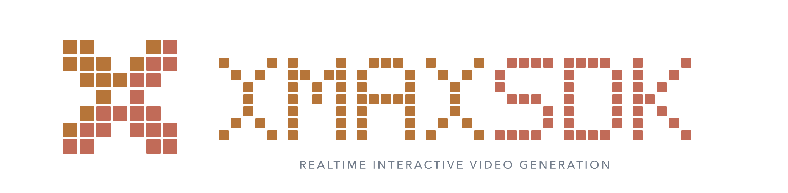
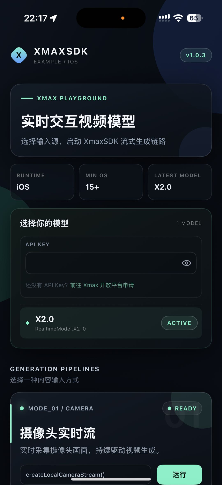
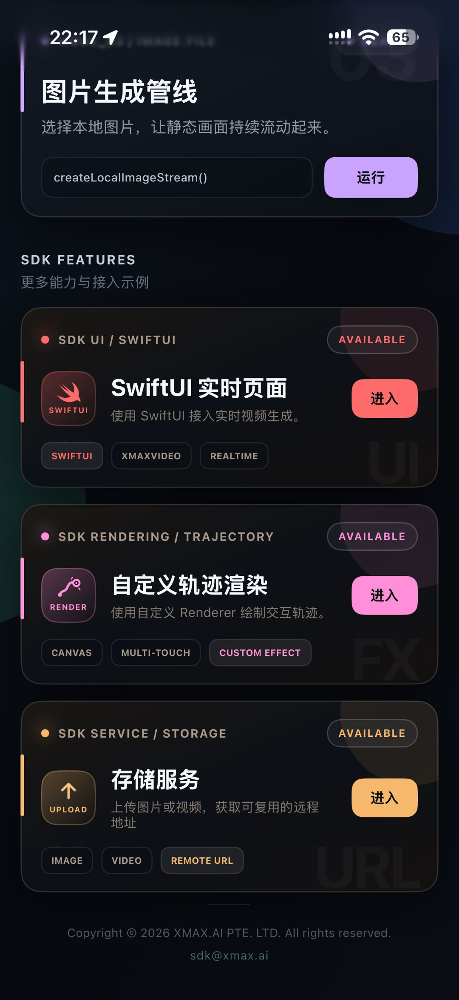
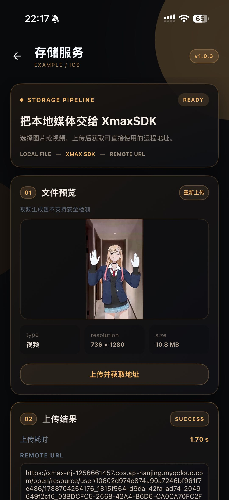
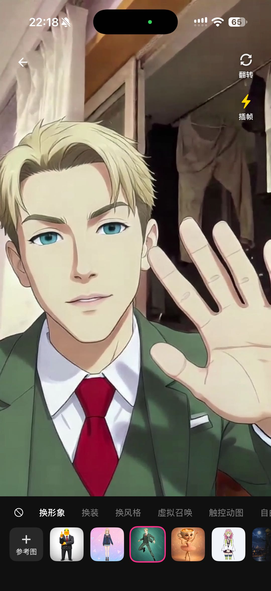

<p align="center">
  
</p>

<p align="center">
  
  
  
  
</p>

We introduce XmaxSDK, a React Native SDK designed for real-time interactive video generation via Xmax models. XmaxSDK implements an end-to-end pipeline covering media acquisition, video streaming, frame-by-frame generation, and on-device rendering, enabling developers to seamlessly integrate low-latency, high-fidelity video transformations into creative applications at a much lower cost than alternative solutions.

<!-- Product demos from the iOS XLab reference application. -->
<p align="center"></p>

<br>

## What you can build with XmaxSDK

<table>
  <tr>
    <th width="24%" align="left">Realtime Use Case</th>
    <th width="60%" align="left">Description</th>
    <th width="16%" align="center">Demo</th>
  </tr>
  <tr>
    <td rowspan="2" width="24%" valign="middle">
      <strong>Character Swapping</strong>
    </td>
    <td width="60%" valign="middle">
      Replace anyone in your live feed with a designated avatar in real-time.
    </td>
    <td rowspan="2" width="16%" align="center" valign="middle">
      <a href="https://cdn.jsdelivr.net/gh/XingMai/XmaxSDK-iOS@88182780abe60b3df1c44f549487fcf8ab4b660c/docs/videos/use-cases/character-swapping.mp4">
        
        <br>
        <sub>▶ Play demo</sub>
      </a>
    </td>
  </tr>
  <tr>
    <td width="60%" valign="middle">
      <strong>Prompt:</strong> <code>视频中角色替换成参考图中角色</code>
      <br><br>
      <strong>Reference image:</strong> Select a clear image of the desired character with a clean background.
    </td>
  </tr>
  <tr>
    <td rowspan="2" width="24%" valign="middle">
      <strong>Virtual Try-On</strong>
    </td>
    <td width="60%" valign="middle">
      Seamlessly change outfits, preserving exact body shape, natural motion, and an
      authentic fit.
    </td>
    <td rowspan="2" width="16%" align="center" valign="middle">
      <a href="https://cdn.jsdelivr.net/gh/XingMai/XmaxSDK-iOS@88182780abe60b3df1c44f549487fcf8ab4b660c/docs/videos/use-cases/virtual-try-on.mp4">
        
        <br>
        <sub>▶ Play demo</sub>
      </a>
    </td>
  </tr>
  <tr>
    <td width="60%" valign="middle">
      <strong>Prompt:</strong> <code>视频中人物衣服替换成参考图中衣服</code>
      <br><br>
      <strong>Reference image:</strong> Select a clear image of the target outfit with a clean background.
    </td>
  </tr>
  <tr>
    <td rowspan="2" width="24%" valign="middle">
      <strong>Video Restyling</strong>
    </td>
    <td width="60%" valign="middle">
      Reimagine your world in any style with an immersive visual experience.
    </td>
    <td rowspan="2" width="16%" align="center" valign="middle">
      <a href="https://cdn.jsdelivr.net/gh/XingMai/XmaxSDK-iOS@88182780abe60b3df1c44f549487fcf8ab4b660c/docs/videos/use-cases/video-restyling.mp4">
        
        <br>
        <sub>▶ Play demo</sub>
      </a>
    </td>
  </tr>
  <tr>
    <td width="60%" valign="middle">
      <strong>Prompt:</strong> <code>视频风格变为参考图指定的风格</code>
      <br><br>
      <strong>Reference image:</strong> Select an image that captures the artistic style you want to apply.
    </td>
  </tr>
  <tr>
    <td rowspan="2" width="24%" valign="middle">
      <strong>AI Companions</strong>
    </td>
    <td width="60%" valign="middle">
      Summon virtual characters into your live camera feed and interact with them
      through gestures.
    </td>
    <td rowspan="2" width="16%" align="center" valign="middle">
      <a href="https://cdn.jsdelivr.net/gh/XingMai/XmaxSDK-iOS@88182780abe60b3df1c44f549487fcf8ab4b660c/docs/videos/use-cases/ai-companions.mp4">
        
        <br>
        <sub>▶ Play demo</sub>
      </a>
    </td>
  </tr>
  <tr>
    <td width="60%" valign="middle">
      <strong>Prompt:</strong> <code>指定角色在场景中互动</code>
      <br><br>
      <strong>Reference image:</strong> Select a clear image of the virtual character you want to summon with a clean background.
    </td>
  </tr>
  <tr>
    <td rowspan="2" width="24%" valign="middle">
      <strong>Live Photo</strong>
    </td>
    <td width="60%" valign="middle">
      Animate and control characters in your images simply by drawing motion
      trajectories.
    </td>
    <td rowspan="2" width="16%" align="center" valign="middle">
      <a href="https://cdn.jsdelivr.net/gh/XingMai/XmaxSDK-iOS@4351aa869d4e24fd40690c670d8949bff270dee0/docs/videos/use-cases/live-photo.mp4">
        
        <br>
        <sub>▶ Play demo</sub>
      </a>
    </td>
  </tr>
  <tr>
    <td width="60%" valign="middle">
      <strong>Prompt:</strong> <code>让画面自然动起来</code>
      <br><br>
      <strong>Reference image:</strong> Use the input image as the reference
    </td>
  </tr>
</table>

<br>

## Why XmaxSDK?

<table>
  <thead>
    <tr>
      <th height="104" align="center" valign="middle">
        <br>Low latency
      </th>
      <th height="104" align="center" valign="middle">
        <br>Cost efficiency
      </th>
      <th height="104" align="center" valign="middle">
        <br>High fidelity
      </th>
    </tr>
  </thead>
  <tbody>
    <tr>
      <td>End-to-end latency is measured in , ensuring that updates to generation conditions and interaction controls are reflected instantly.</td>
      <td>Run on a , reducing inference costs by orders of magnitude versus datacenter GPUs like H100.</td>
      <td>Our models support real-time generation at up to , delivering production-ready, high-quality video output.</td>
    </tr>
  </tbody>
</table>

<br>

## Prerequisites

- iOS 15.1 or later / Android API 26 or later
- React Native 0.87.1 / React 19.2.3, New Architecture
- TypeScript 6
- An Xmax API key

> [!WARNING]
> Never commit your Xmax API key to version control. Pass it securely at
> runtime or use short-lived temporary keys issued by the Xmax API. For step-by-step
> instructions, see [Authentication](https://platform.xmaxai.com/docs/authentication).

<br>

## Installation

```sh
npm install @xmaxai/react-native-sdk@1.1.1 \
  react-native-cos-sdk-nobeacon@1.3.0 \
  react-native-blob-util@0.24.10
```

<br>

## Quick Start

Use your front camera to turn yourself into a character from a reference image in real time.

```tsx
import { useState } from 'react';
import {
  CameraPosition,
  RealtimeModel,
  XmaxClient,
  XmaxEnvironment,
  XmaxRealtimeDualVideo,
  type RealtimeVideoTrack,
} from '@xmaxai/react-native-sdk';

// Initialize the client.
const client = new XmaxClient({
  apiKey: '<YOUR_XMAX_API_KEY>',
  environment: XmaxEnvironment.global,
});

// Initialize the realtime manager.
const realtime = client.createRealtimeManager({
  model: RealtimeModel.x2_1,
});

// Declare state inside your screen component and return videoView in its JSX.
const [localTrack, setLocalTrack] = useState<RealtimeVideoTrack | null>(null);
const [remoteTrack, setRemoteTrack] = useState<RealtimeVideoTrack | null>(null);

const videoView = (
  <XmaxRealtimeDualVideo
    style={{ flex: 1 }}
    localTrack={localTrack}
    remoteTrack={remoteTrack}
  />
);

// Create a camera stream and display the preview.
const localStream = await realtime.createLocalCameraStream({
  position: CameraPosition.front,
});
setLocalTrack(localStream.videoTrack);

// Once the preview is Ready, start generation and display the result.
const remoteStream = await realtime.startGeneration({
  localStream,
  context: {
    prompt: '视频中角色替换成参考图中角色',
    referencePath:
      'https://cdn.xmax.ai/images/playground/charx/charx_image1.png?v=26&presetVersion=20261022',
  },
});
setRemoteTrack(remoteStream.videoTrack);

// Release resources when leaving the screen.
await realtime.close();
```

<br>

## Example Project

A complete example application featuring a React Native implementation
is available in [`Example/XLab`](./Example/XLab).
It demonstrates real-time generation using live camera feeds and static images.

<p align="center"></p>

<br>

## Dependencies

- <ins><strong>Agora RTC SDK</strong></ins> enables low-latency, real-time audio and video communication.
- <ins><strong>Tencent Cloud COS SDK</strong></ins> handles media upload and download via object storage.

Agora 4.6.4 is installed through CocoaPods and Gradle. Other dependency versions
are listed in [`package.json`](./package.json).

<br>

## Contact us

For bug reports and feature requests, please open a
[GitHub Issue](https://github.com/XingMai/XmaxSDK-RN/issues). For integration
assistance and technical support, contact us at [sdk@xmax.ai](mailto:sdk@xmax.ai).

<br>

## License

XmaxSDK is available under the terms of the [MIT License](LICENSE).
